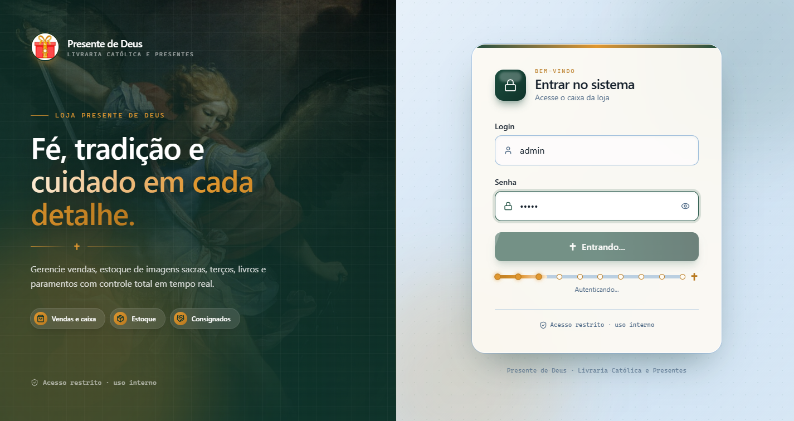
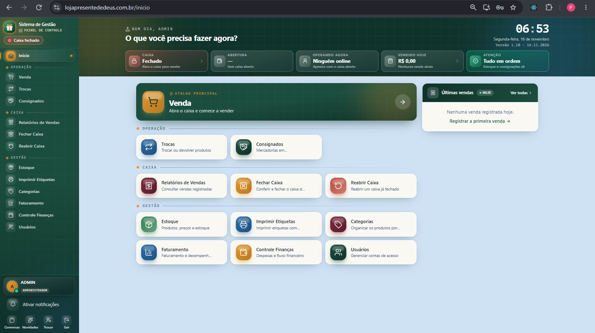

<div align="center">

# 🎁 PDV Presente de Deus — Frontend

**Sistema de gestão e ponto de venda (PDV) para a livraria católica e loja de presentes _Presente de Deus_.**

Vendas e caixa · Estoque · Consignados · Trocas · Etiquetas · Financeiro


[🌐 Ver em produção](https://pdvlojapresentededeus-frontend.vercel.app) · [🛠️ Backend](https://github.com/pedroleonidasdev/loja)

</div>

---

## 📸 Telas

| Login | Painel inicial |
| :---: | :---: |
|  |  |

> As capturas ficam em `docs/screenshots/`.

---

## 📖 Sobre o projeto

Este repositório contém o **frontend** do sistema usado no dia a dia da loja *Presente de Deus – Livraria Católica e Presentes*: controle de caixa, vendas, estoque de imagens sacras, terços, livros e paramentos, mercadorias em consignação, trocas e finanças.

A interface consome a API REST do [backend](https://github.com/pedroleonidasdev/loja) (Spring Boot + MySQL) e foi pensada para uso interno, com acesso restrito por login e perfis de permissão.

---

## ✨ Funcionalidades

### Operação
- **Venda (PDV):** abertura de caixa, carrinho, formas de pagamento e desconto percentual sobre o total da venda
- **Trocas:** troca e devolução de produtos, com comprovante
- **Consignados:** controle de mercadorias em consignação, comissão por categoria, relatório e geração de recibo em Word, com pré-visualização antes de imprimir

### Caixa
- **Relatórios de vendas:** consulta das vendas registradas
- **Fechar e reabrir caixa:** conferência no fechamento e reabertura de caixas já fechados
- **Status do caixa na sidebar:** mostra quem abriu o caixa e quando

### Gestão
- **Estoque:** produtos, preços e quantidades, com alteração de categoria em lote
- **Imprimir etiquetas:** etiquetas de preço com pré-impressão (suporte a impressora térmica Elgin L42 Pro via ZPL)
- **Categorias:** organização dos produtos por categoria
- **Faturamento:** visão de faturamento e desempenho
- **Controle Finanças:** despesas e fluxo financeiro, ordenados por data
- **Usuários:** contas de acesso, perfis e encerramento de sessões

### Recursos extras
- 🔔 **Notificações push** para administradores (por exemplo, abertura e fechamento de caixa)
- 💬 **Conversas:** chat de suporte dentro do sistema
- 🔐 **Autenticação com perfis:** `ADMIN` e `CAIXA`

---

## 🧰 Tecnologias

| Camada | Tecnologia |
| --- | --- |
| Framework | [Next.js](https://nextjs.org/) (App Router) |
| UI | [React](https://react.dev/) + [Tailwind CSS](https://tailwindcss.com/) |
| Linguagem | [TypeScript](https://www.typescriptlang.org/) |
| Qualidade | ESLint |
| Hospedagem | [Vercel](https://vercel.com/) |

**Infraestrutura do sistema completo:** frontend na Vercel → API Spring Boot no Render → banco MySQL no Clever Cloud.

---

## 🗂️ Estrutura do projeto

```text
├── app/              # Rotas e páginas (App Router)
├── components/       # Componentes reutilizáveis (sidebar, badges, visualizadores…)
├── lib/              # API client, tipos, formatadores, contexto de autenticação, push
├── public/           # Arquivos estáticos e service worker
├── .env.local.example
└── package.json
```

---

## 🚀 Como rodar localmente

### Pré-requisitos

- [Node.js](https://nodejs.org/) 20 ou superior
- npm
- [Backend](https://github.com/pedroleonidasdev/loja) rodando localmente ou uma URL de API disponível

### Passo a passo

```bash
# 1. Clone o repositório
git clone https://github.com/pedroleonidasdev/pdvlojapresentededeus-frontend.git
cd pdvlojapresentededeus-frontend

# 2. Instale as dependências
npm install

# 3. Configure as variáveis de ambiente
cp .env.local.example .env.local
# No Windows (PowerShell): Copy-Item .env.local.example .env.local

# 4. Inicie o servidor de desenvolvimento
npm run dev
```

Acesse [http://localhost:3000](http://localhost:3000).

### Variáveis de ambiente

Edite o `.env.local` com a URL da API do backend (veja o nome exato da variável em `.env.local.example`):

```env
NEXT_PUBLIC_API_URL=http://localhost:8080
```

### Scripts

| Comando | Descrição |
| --- | --- |
| `npm run dev` | Servidor de desenvolvimento |
| `npm run build` | Build de produção |
| `npm run start` | Executa o build de produção |
| `npm run lint` | Verifica o código com ESLint |

---

## 🔑 Primeiro acesso

O backend cria automaticamente os usuários iniciais (`admin` e `caixa`) na primeira execução. Consulte o README do [backend](https://github.com/pedroleonidasdev/loja) para ver as credenciais padrão.

> ⚠️ **Troque as senhas padrão imediatamente** na tela **Usuários** (perfil ADMIN), principalmente em ambiente de produção.

---

## ☁️ Deploy

O deploy do frontend é feito na **Vercel**, conectado à branch `main`: cada push gera um novo deploy.

Configure na Vercel a mesma variável de ambiente da API apontando para o backend em produção.

---

## 🗺️ Roadmap

- [ ] Testes automatizados
- [ ] Teste de impressão real na Elgin L42 Pro
- [ ] Modo offline para vendas

---

## 👨‍💻 Autor

**Pedro Leonidas de Oliveira Campos**

[](https://github.com/pedroleonidasdev)
[](https://pedroleonidasdev.com.br)

---

<div align="center">

Feito com ☕ e fé para a **Presente de Deus – Livraria Católica e Presentes**

</div>
